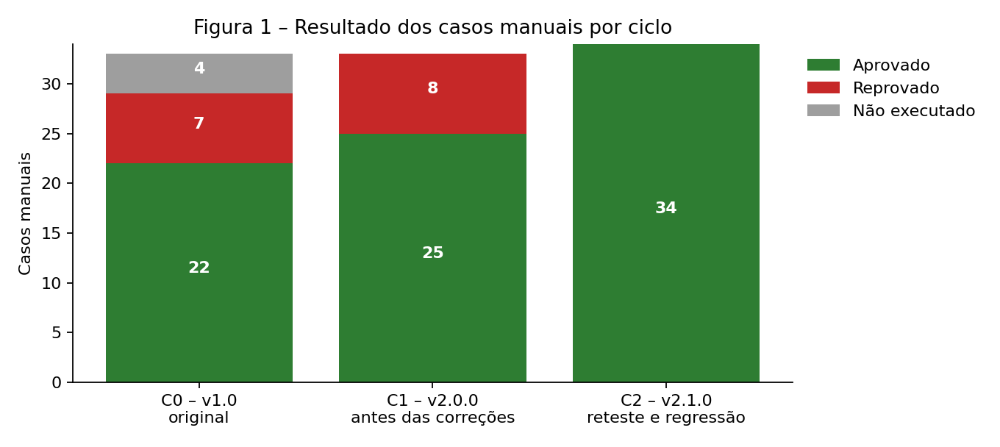
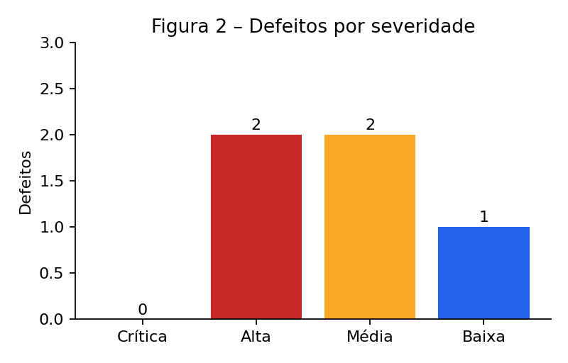
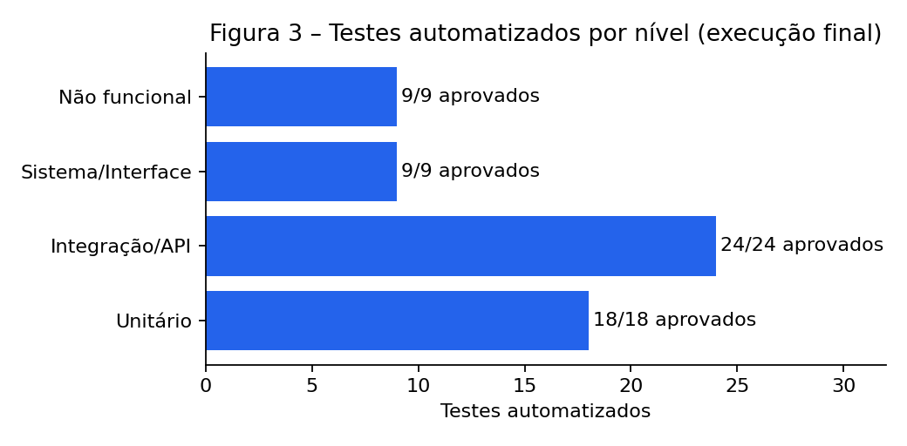
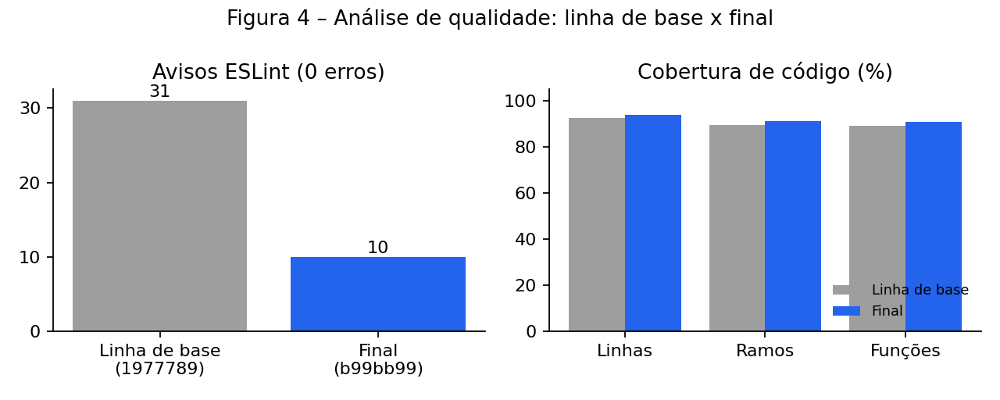

# 1. Fontes dos dados

Todos os valores foram calculados automaticamente por `docs/ferramentas/gerar_artefatos.py` a partir dos arquivos reais de execução:

- `resultados/execucoes/C0`, `C1` e `C2`, com 100 registros de execução;
- `resultados/pipeline/*.log` e `resultados/postman/newman-relatorio.json`;
- `resultados/nao-funcionais/nf-resultados.json` e `resultados/qualidade/*`;
- `docs/dados/defeitos.json`.

A planilha de cálculo é `P10_metricas.xlsx`.

Ciclos de execução manual:

| Ciclo | Versão | Planejados | Executados | Aprovados | Reprovados | Não executados |
|---|---|---|---|---|---|---|
| C0 | 1.0 original | 33 | 29 | 22 | 7 | 4 (função inexistente na v1.0) |
| C1 | 2.0.0 (`1977789`), antes das correções | 33 | 33 | 25 | 8 | 0 |
| C2 | 2.1.0 (`b99bb99`), reteste e regressão | 34 | 34 | 34 | 0 | 0 |

# 2. Painel mínimo de métricas (Apêndice K)

| Indicador | Valor | Fonte dos dados | Interpretação |
|---|---|---|---|
| Percentual de execução | **100%** em C2 (34/34). C1: 100% (33/33). C0: 87,88% (29/33) | Registros de execução C0–C2 | A execução final cobriu todo o catálogo. Em C0, 4 casos não foram executados porque histórico, exclusão e logout não existiam na v1.0. |
| Taxa de aprovação | C1: **75,76%** (25/33) → C2: **100%** (34/34) | Registros C1 e C2 | Um quarto dos casos falhava antes das correções. Depois das correções e da regressão, todos os resultados ficaram conformes. |
| Taxa de reprovação | C1: **24,24%** (8/33) → C2: **0%** | Registros C1 e C2 | As 8 reprovações de C1 vieram de 4 defeitos (BUG-001, 002, 003 e 005). Nenhuma permaneceu. |
| Cobertura de requisitos | **100%** (15/15) | Matriz de rastreabilidade | Todo requisito no escopo tem pelo menos um teste executado e aprovado. RF-11 e os RNF também têm testes automatizados. |
| Taxa de automação | **100%** (25/25) | Catálogo (coluna "Candidato à automação") × testes aprovados | Todos os 25 casos marcados como candidatos têm teste automatizado aprovado. Os outros 9 casos foram deixados manuais de propósito: mesma partição já automatizada ou baixo risco. |
| Defeitos por severidade | Alta: 2 · Média: 2 · Baixa: 1 · Crítica: 0 | `defeitos.json` | Os dois defeitos de severidade Alta (limites de idade e acesso sem login) atingiam diretamente a regra de negócio e a segurança. |
| Defeitos por status | Encerrado: 5 | `defeitos.json` | Nenhum defeito aberto. O critério de saída "nenhum defeito Alta/Crítica aberto" foi atendido. |
| Taxa de reabertura | **0%** (0/5) | Reteste C2 | As correções não precisaram ser refeitas e não houve regressão. |

# 3. Indicadores complementares

| Indicador | Linha de base | Final | Interpretação |
|---|---|---|---|
| Testes automatizados aprovados | 39 de 46 no pipeline inicial (unit 10/15, API 11/11, Postman 12/12, e2e 6/8) | 60/60 (unit 18, API 12, Postman 12, e2e 9, NF 9) | A automação passou a cobrir RF-11 e os RNF. |
| Avisos de análise estática (ESLint) | 31 (28 números mágicos, 2 funções longas, 1 complexidade) | 10 | Queda de 67,7% após o refactor do TDD. Os 10 restantes estão no plano de melhoria (P11). |
| Erros de análise estática | 0 | 0 | — |
| Cobertura de linhas / ramos / funções | 92,59% / 89,61% / 89,29% | 93,80% / 91,01% / 90,70% | Acima do critério de 85%. As linhas não cobertas ficam no tratamento de erros do servidor de arquivos estáticos. |
| Densidade de defeitos | — | 0,33 defeito por requisito (5/15) | Concentrada em RF-02, RF-06, RF-07 e RNF-03. |
| Detecção por técnica | — | Valor limite: BUG-001 · Exceção: BUG-002 · Estados: BUG-003 · Segurança básica: BUG-004 · Partição inválida: BUG-005 | Cada técnica encontrou um tipo diferente de defeito. A partição sozinha (CT-06 com 30 anos) não teria encontrado o BUG-001. |

# 4. Gráficos

A Figura 1 mostra a evolução de C0/C1, com cerca de 24% de reprovação, para C2, com 100% de aprovação. O caso extra em C2 é o CT-34, criado depois do TDD.

A Figura 3 mostra uma distribuição próxima da pirâmide de testes: muitos unitários e de integração, poucos de interface (que são mais lentos e frágeis).

# 5. Limitações das métricas

- O número total de casos é pequeno (34), então variações percentuais pesam muito.
- A taxa de automação considera apenas os casos que o próprio grupo marcou como candidatos.
- As medições de desempenho valem só para o ambiente local, com um usuário.
- A análise de qualidade usou ESLint e cobertura no lugar do SonarQube (sem Docker/servidor disponível).
