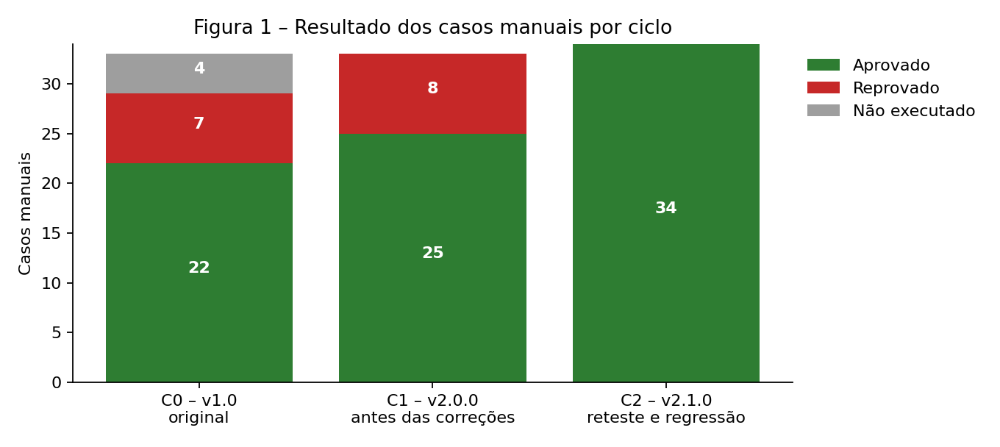
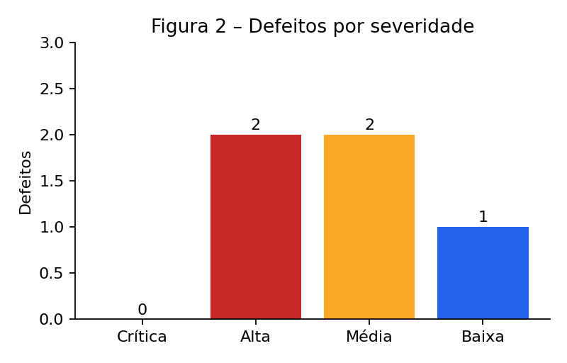
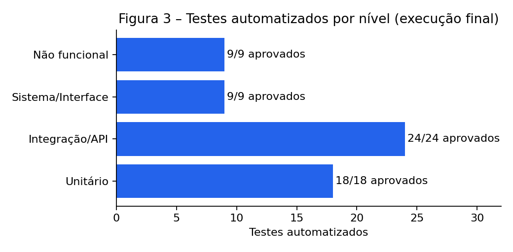
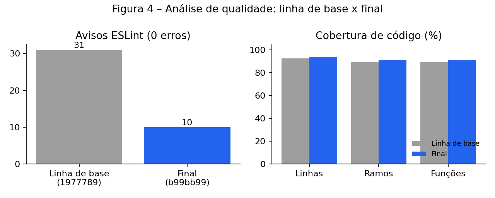

::: capa
**UNISAGRADO**

Curso de Ciência da Computação

Disciplina: Testes e Qualidade de Software

**PROJETO INTEGRADO P2**

**Planejamento, execução e avaliação da qualidade do Simulador de Empréstimo**

Sistema testado: Simulador de Empréstimo – versão 2.1.0

Integrantes: Jonathans David da Silva P Jr · Lucas Soares de Almeida · Pedro Henrique Teixeira Moroni · Guilherme de Oliveira Lazari

Professor: Prof. Dr. Elvio Gilberto da Silva

Bauru – 2026
:::

# Folha de identificação

| Item | Informação |
|---|---|
| Turma | Ciência da Computação – Turma B |
| Integrantes e RA | Jonathans David da Silva P Jr – 23110246; Lucas Soares de Almeida – 23210133; Pedro Henrique Teixeira Moroni – 23110956; Guilherme de Oliveira Lazari – 23110982 |
| Repositório | https://github.com/tathans-js/simulador-emprestimo |
| Pipeline (GitHub Actions) | https://github.com/tathans-js/simulador-emprestimo/actions |
| Defeitos (GitHub Issues) | https://github.com/tathans-js/simulador-emprestimo/issues?q=is%3Aissue |
| Vídeo de contingência | «PREENCHER: link ou 14_APRESENTACAO_E_VIDEO_CONTINGENCIA/video.mp4» |
| Pasta do Drive | P2_TQS_2026_CC-B_SIMULADOR-EMPRESTIMO |

**Declaração de participação:** declaramos que todos os integrantes participaram das etapas descritas e conseguem explicar os documentos e testes produzidos. A contribuição de cada um está no Diário de Participação (P14). Declaramos também que foi usada ferramenta de inteligência artificial (assistente de código) como apoio na automação e na documentação, conforme o item 15 do manual. Todos os resultados vêm de execuções reais e reproduzíveis, e cabe ao grupo revisá-los e validá-los.

# 1. Introdução

**Contexto.** Simuladores de crédito aplicam regras objetivas (faixa etária, comprometimento de renda, situação cadastral). Nesse tipo de regra, um erro de fronteira, como aceitar 61 anos ou recusar 18, afeta clientes legítimos e gera risco ao negócio.

**Problema.** Como mostrar, com um processo de teste planejado, executado e documentado, que o Simulador de Empréstimo atende aos requisitos selecionados, e quais riscos, defeitos e melhorias permanecem antes de liberá-lo aos usuários?

**Justificativa.** A versão 1.0 tinha apenas 15 casos de teste, sem automação, sem persistência e sem integração entre componentes. Isso não atendia ao item 5.3 do manual nem permitia aplicar os níveis de integração, sistema e CI/CD.

**Objetivo.** Elaborar e executar uma estratégia integrada de testes (manuais e automatizados em 4 níveis, não funcionais e de aceitação), registrar e acompanhar os defeitos até o encerramento, calcular métricas com dados reais, evoluir o sistema por TDD e automatizar a execução em um pipeline de CI.

# 2. Caracterização do sistema

- **Finalidade:** simular a concessão de empréstimo a partir de idade, renda mensal, valor solicitado e situação da conta. O sistema informa aprovação ou negação (com motivos) e mantém um histórico.
- **Usuários:** analista de crédito (perfil único, usuário fictício `admin`).
- **Tecnologias:** HTML/CSS/JavaScript; Node.js 22+ (`node:http`); persistência em arquivo JSON.
- **Arquitetura resumida:** a interface (`public/`) faz chamadas REST com token Bearer à API (`src/servidor.js`). A API usa as regras (`src/regras.js`), a autenticação (`src/auth.js`) e o repositório (`src/repositorio.js`), que grava em `data/simulacoes.json`.

| Versão | Descrição | Commit |
|---|---|---|
| 1.0 | Página única; regras e login no navegador; sem persistência | `1aa6f8d` |
| 2.0.0 | API REST, autenticação no servidor, histórico persistido, exclusão, logout. Regras da v1.0 portadas **sem alteração** | `8e64f72` |
| 2.1.0 | Correções BUG-001/002/003/005 e RF-11 (TDD) | `b99bb99` (**versão testada final**) |

# 3. Escopo, requisitos e riscos

Foram selecionados **15 requisitos**: 11 funcionais e 4 não funcionais. Os itens fora do escopo são carga/estresse, multiusuário, HTTPS, Safari/Edge e acessibilidade completa (detalhes no P02).

{{tabela:requisitos}}

**Matriz de riscos** (12 riscos; os de prioridade Alta foram executados primeiro e repetidos na regressão):

{{tabela:riscos}}

# 4. Planejamento dos testes

**Estratégia:** pirâmide de testes, com o maior volume de testes no nível unitário (regras de maior risco), integração para o contrato da API e a persistência, e poucos testes de interface para os fluxos críticos. Execução manual em ciclos (C0 na v1.0, C1 na v2.0 antes das correções e C2 de reteste e regressão), aceitação com representante e não funcionais seguros.

| Nível | Ferramenta | Qtde. (mín.) |
|---|---|---|
| Unitário | `node:test` | 18 (6) |
| Integração/API | `node:test` + `fetch`; Postman/Newman | 12 + 12 requisições (5) |
| Sistema/interface | Selenium WebDriver (Chrome/Firefox headless) | 9 (4) |
| Manual (sistema) | Navegador + executor assistido com capturas | 34 casos / 96 execuções (24/24) |
| Aceitação | Roteiro com representante | 4 cenários (4) |
| Não funcional | `node:test` + Selenium | 9 em 4 categorias (6 em 3) |

**Técnicas:** partição de equivalência, valor limite (2 e 3 valores), tabela de decisão, teste baseado em estados, casos de uso, exceção, segurança básica e exploratório.

**Ambiente:** macOS 26.5, Node.js 24.22.2, Chrome 157, Firefox 160 (local) e Ubuntu com Node 22 no GitHub Actions. Os dados são fictícios e cada teste usa um arquivo de dados temporário.

**Critérios de saída:** 100% dos casos executados; nenhum defeito Alta/Crítica aberto; automação verde; cobertura de requisitos de 100%; cobertura de linhas de pelo menos 85%. **Todos foram atingidos** (seção 10). Plano completo no P03.

# 5. Especificação dos casos

O catálogo completo, com pré-condições, dados, passos numerados, resultado esperado e candidatura à automação, está em `P04_P05_catalogo_e_rastreabilidade.xlsx`. Os 34 casos se dividem em:

- **por tipo:** 7 positivos, 9 negativos, 9 de limite, 2 alternativos e 7 de exceção;
- **por requisito** (um caso pode cobrir mais de um): RF-01 tem 6 casos; RF-02, 7; RF-03, 3; RF-04, 1; RF-05, 5; RF-06, 7; RF-07, 6; RF-08, 2; RF-09, 1; RF-10, 1; RF-11, 1; RNF-03, 2; RNF-04, 1. RNF-01 e RNF-02 são cobertos pelos testes não funcionais automatizados.

{{tabela:casos_resumo}}

**Matriz de rastreabilidade** (requisito → risco → casos → automação → execuções → defeitos):

{{tabela:rastreabilidade}}

# 6. Execução manual e defeitos

## 6.1 Execução

Os casos foram executados com o **executor assistido** (`scripts/executar_casos.js`). Ele segue no navegador exatamente os passos de cada caso, compara o resultado esperado com o obtido e salva uma captura de tela com carimbo (caso, execução, versão, data/hora e resultado). Cada execução tem identificador (EX-C*n*-*nn*) e evidência em `resultados/execucoes/`.

> Observação: o grupo deve repetir manualmente, na apresentação, ao menos os casos CT-08, CT-21 e CT-27, para mostrar a execução humana dos passos (item 9.6).

{{tabela:execucao_resumo}}

## 6.2 Defeitos

{{tabela:defeitos_resumo}}

O BUG-001 foi **inserido intencionalmente** pelo autor da v1.0, conforme comentário no código. Ele foi mantido porque existia no código testado, e sua origem está declarada no P07. Os relatórios completos (Apêndice G) estão no P07 e em `P07_defeitos.xlsx`.

## 6.3 Reteste e regressão

Depois das correções (commits `59502b6`, `f69ffc3`, `9e18b69` e `71040c7`), o ciclo **C2** reexecutou **todo o catálogo** (34 casos): reteste dos 10 casos ligados a defeitos e regressão dos demais. Resultado: 34/34 aprovados e nenhuma reabertura.

## 6.4 Teste exploratório

Uma sessão exploratória na API (`scripts/sessao_exploratoria.js`) testou entradas fora do catálogo: idade decimal, texto, valores enormes, domínio da conta, campos extras, corpo de 200 KB e duplo envio. **Nenhum requisito foi violado.** Os campos extras não sobrescrevem o `id`, e o corpo grande é recusado com 400. Ficaram 3 observações de melhoria (OBS-01 a OBS-03), que não foram registradas como defeito porque o requisito não define o comportamento esperado.

# 7. Automação

| Suíte | Arquivo | Comando | Resultado final |
|---|---|---|---|
| Unitária (18) | `tests/unit/regras.test.js` | `npm run test:unit` | 18/18 |
| Integração/API (12) | `tests/api/api.test.js` | `npm run test:api` | 12/12 |
| Postman (12 req., 24 asserções) | `postman/*.json` | `npm run test:postman` | 24/24 asserções |
| Sistema/interface (9) | `tests/e2e/fluxos.test.js` | `npm run test:e2e` | 9/9 |
| Não funcionais (9) | `tests/nao-funcionais/nf.test.js` | `npm run test:nf` | 9/9 |

**Arquitetura dos testes:**

- O helper `tests/apoio/servidor.js` sobe o servidor real em porta livre, com arquivo de dados temporário (isolamento).
- O helper `tests/apoio/navegador.js` centraliza o WebDriver e as ações (login, simular, aguardar texto).
- Os testes Selenium usam esperas explícitas (`until.elementTextContains`), sem esperas fixas, e salvam captura em caso de falha.
- O nome de cada teste traz o requisito e o caso (por exemplo, `UT-03 [RF-02/CT-08]`), o que dá rastreabilidade.

**Limitações:**

- O executor assistido usa uma pausa curta (400 ms) após o clique.
- O Firefox não roda no pipeline (só local).
- O Selenium precisa do download do driver na primeira execução.

# 8. Integração e sistema

**Comunicações validadas:**

- interface ⇄ API (JSON + token Bearer): E2E-01 a E2E-09;
- API ⇄ regras: IT-04 a IT-06 e IT-12;
- API ⇄ repositório ⇄ arquivo: IT-04, IT-07 e IT-10;
- autenticação: IT-01 a IT-03 e IT-09;
- contrato básico e encadeamento de dados (token e `simId`): coleção Postman PM-01 a PM-12, com variáveis de ambiente, fluxos positivos e negativos de cada operação crítica e verificação do tempo de resposta.

**Fluxos ponta a ponta:**

- login válido e inválido;
- simulação aprovada com registro no histórico;
- negação com motivo;
- estados (finalizar sem simular e bloqueio após Finalizado);
- exclusão;
- logout.

# 9. Aceitação e não funcionais

**Aceitação:** 4 cenários (AC-01 a AC-04) escritos do ponto de vista do analista de crédito, com dados e critério de sucesso. Todos têm pré-validação técnica aprovada. **A execução pelo representante do usuário e a decisão (Aceito / Aceito com ressalvas / Não aceito) estão pendentes:** «PREENCHER com os resultados reais da sessão com o representante». Essa sessão também cobre a usabilidade (tempo, erros, compreensão e satisfação).

**Não funcionais** (9 testes, 4 categorias, todos atendidos):

{{tabela:nf}}

# 10. Métricas e indicadores

| Indicador | Fórmula | Valor |
|---|---|---|
| Percentual de execução | executados / planejados × 100 | C2: 34/34 = **100%** (C0: 87,88%) |
| Taxa de aprovação | aprovados / executados × 100 | C1: 25/33 = **75,76%** → C2: 34/34 = **100%** |
| Taxa de reprovação | reprovados / executados × 100 | C1: 8/33 = **24,24%** → C2: **0%** |
| Cobertura de requisitos | requisitos com teste executado / requisitos no escopo × 100 | 15/15 = **100%** |
| Taxa de automação | automatizados / planejados para automação × 100 | 25/25 = **100%** |
| Defeitos por severidade | contagem | Alta 2 · Média 2 · Baixa 1 |
| Defeitos por status | contagem | Encerrado 5 |
| Taxa de reabertura | reabertos / retestados × 100 | 0/5 = **0%** |

**Interpretação:**

- Antes das correções, cerca de 1 em cada 4 casos falhava. As falhas se concentravam nas fronteiras (RF-02), nas entradas vazias e negativas (RF-07) e nas transições de estado (RF-06), ou seja, exatamente onde as técnicas de valor limite, exceção e estados foram aplicadas.
- O caminho feliz (CT-06, 30 anos) passou em todos os ciclos. Com ele sozinho, nenhum desses defeitos teria sido encontrado.
- Depois das correções, a regressão completa não mostrou efeitos colaterais (0% de reabertura).

Análise completa no P10.

# 11. TDD, CI/CD e melhoria contínua

**TDD (RF-11 – motivos da negação):**

- **RED** `a44e590`: 5 testes novos falhando pelo motivo esperado.
- **GREEN** `263e841`: implementação mínima, com todas as suítes verdes.
- **REFACTOR** `ab1b0f7`: constantes nomeadas, tabela de regras e rotas em mapa, com as suítes ainda verdes. Os avisos ESLint caíram de 31 para 10.

Os logs de cada etapa estão em `resultados/tdd/`.

**CI/CD:** o arquivo é `.github/workflows/ci.yml`, disparado em push e pull request. Etapas: preparar o ambiente, instalar, rodar os testes em 4 níveis e publicar os resultados. A demonstração local com as mesmas etapas registrou:

- **execução com falha** no commit `1977789` (5 falhas unitárias e 2 de interface);
- **execução aprovada** no commit `b99bb99`.

No GitHub Actions:

- **falha controlada** no ramo `demo-pipeline-falha` (código da v2.0.0): https://github.com/tathans-js/simulador-emprestimo/actions/runs/44624710466;
- **aprovada** no `main` (`b34cd5a`): https://github.com/tathans-js/simulador-emprestimo/actions/runs/44624726112.

O pipeline também revelou uma falha de ambiente: com Node 20, o `node --test` não aceita padrões glob (https://github.com/tathans-js/simulador-emprestimo/actions/runs/44624223998). A correção foi usar Node 22 no pipeline (commit `b34cd5a`).

**Análise de qualidade:** foram feitas 2 execuções (linha de base e final) com ESLint e cobertura, no lugar do SonarQube, porque o ambiente não tinha Docker nem servidor. A troca precisa de autorização. O plano de melhoria contínua tem 7 ações priorizadas (M-01 a M-07), com responsáveis e critérios de verificação (P11).

# 12. Discussão dos resultados

**Pontos fortes:**

- Rastreabilidade completa: o ID do requisito aparece no nome dos testes, nos casos, nas execuções e nos defeitos.
- Testes reproduzíveis com um comando, isolados por arquivo temporário.
- Evidências carimbadas.
- Ciclo TDD visível no histórico do Git.
- Defeitos encontrados por técnicas diferentes.

**Pontos frágeis:**

- Toda a automação e a documentação foram consolidadas em um curto período, em vez de evoluírem ao longo do semestre.
- A aceitação ainda não foi feita com um representante externo.
- O pipeline só foi publicado no GitHub ao final, e a primeira execução revelou incompatibilidade de ambiente (Node 20).
- O SonarQube foi substituído por outra ferramenta.
- O executor assistido torna a execução "manual" mais próxima da automatizada.

**Riscos residuais:**

- R-10: sessões sem expiração por tempo e sem limite de tentativas de login.
- OBS-02: domínio do campo conta não é validado.
- OBS-03: duplo envio grava duas simulações.
- Persistência em arquivo inadequada para uso concorrente.
- Desempenho medido só com um usuário.

**Limitações:** o sistema é acadêmico e pequeno, com um único perfil de usuário. Os resultados de desempenho e compatibilidade valem para o ambiente descrito.

# 13. Conclusão

No escopo definido, o Simulador de Empréstimo 2.1.0 atende aos 15 requisitos selecionados:

- 100% dos casos manuais foram aprovados no ciclo de regressão;
- os 60 testes automatizados em 4 níveis foram aprovados;
- os 5 defeitos registrados foram encerrados sem reabertura;
- a cobertura de linhas chegou a 93,8%.

A versão 1.0 original **não estava apta**: rejeitava clientes de 18 e 60 anos, aceitava campos vazios como zero, permitia transições de estado inválidas e podia ser usada sem login.

**Prontidão:** a versão 2.1.0 está **apta para uso em ambiente acadêmico/demonstração**, condicionada a:

1. aceitação pelo representante do usuário (AC-01 a AC-04);
2. tratamento das melhorias M-02 e M-06 antes de qualquer uso com dados reais.

O projeto mostrou na prática que testar só o caminho feliz é insuficiente: os defeitos estavam nas fronteiras, nas exceções e nos estados.

# Referências

- UNISAGRADO. *Projeto Integrado P2 – Manual completo de desenvolvimento e entrega*. Testes e Qualidade de Software, 2026.
- Node.js. *Test runner (`node:test`)*. Documentação oficial, versão 24.
- SeleniumHQ. *Selenium WebDriver – JavaScript bindings*, versão 4.
- Postman. *Newman – command-line collection runner*, versão 6.
- ESLint. *Rules reference*, versão 9.
- GitHub. *GitHub Actions documentation*.

# Apêndices e anexos

| Apêndice | Conteúdo | Arquivo |
|---|---|---|
| A | Ficha de proposta e aprovação | P01 |
| B, C | Catálogo de requisitos e matriz de riscos | P02 e `P02_requisitos_e_riscos.xlsx` |
| D | Plano de testes | P03 |
| E, H | Catálogo de casos e matriz de rastreabilidade | `P04_P05_catalogo_e_rastreabilidade.xlsx` |
| F | Registro de execução (C0, C1 e C2) e capturas | `P06_registro_de_execucao.xlsx`, `resultados/execucoes/` |
| G | Relatórios de defeito | P07, `P07_defeitos.xlsx/.csv` |
| I | Registros não funcionais | P09, `resultados/nao-funcionais/` |
| J | TDD e CI/CD | P11, `resultados/tdd/`, `resultados/pipeline/` |
| K | Painel de métricas | P10, `P10_metricas.xlsx` |
| L, M | Diário de participação e declaração final | P14 |
| — | Planilha mestre com todas as abas | `PLANILHA_MESTRE_P2.xlsx` |
